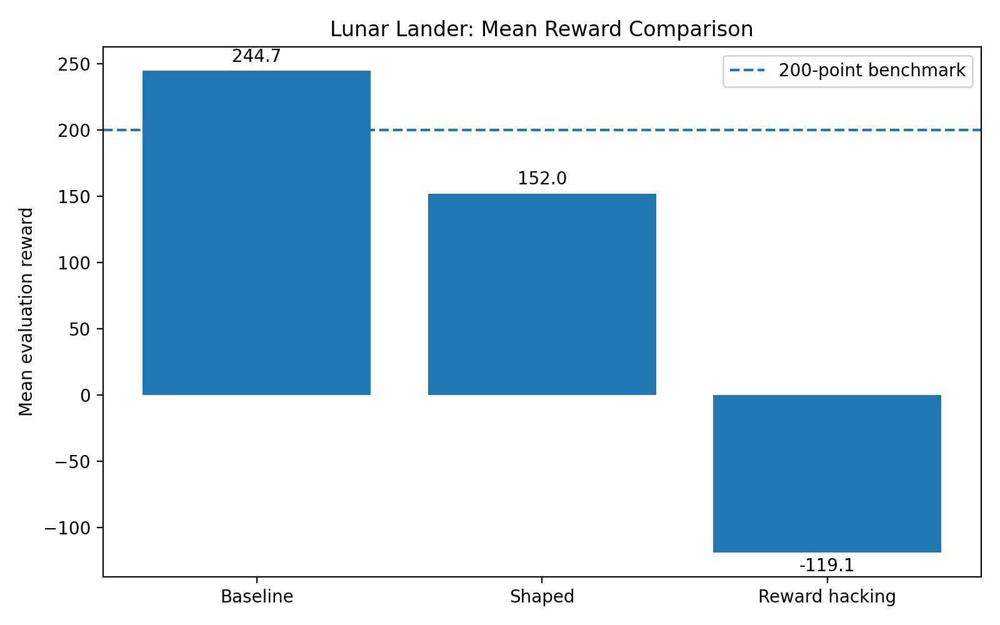
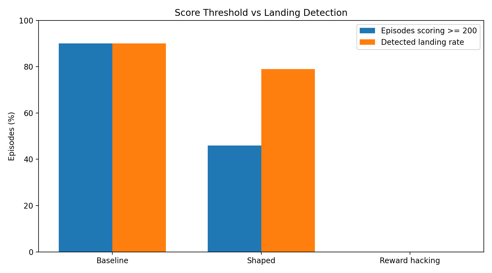
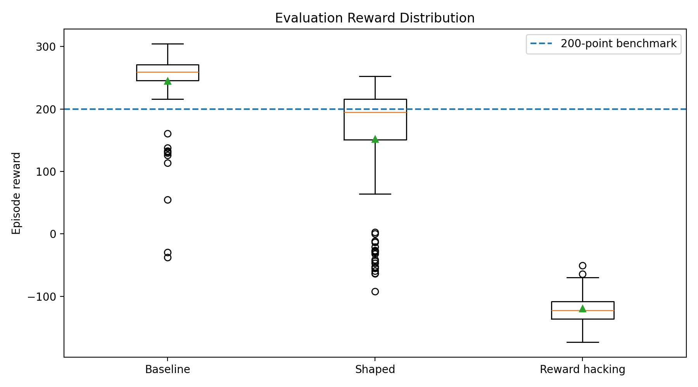

# Rocket Landing AI Using Reinforcement Learning and Reward Shaping

An experimental reinforcement-learning project that trains an AI agent to control a simulated lunar lander using Proximal Policy Optimization (PPO). The project compares the environment's native reward function against custom reward shaping and a deliberately flawed reward design.

## Project Overview

The objective is to investigate how reward design influences reinforcement-learning behavior.

Three agents are trained and evaluated:

1. **Baseline:** Uses the original Gymnasium Lunar Lander reward.
2. **Shaped reward:** Adds potential-based progress rewards and a small time penalty.
3. **Reward hacking:** Adds a bonus when the lander is nearly upright and moving slowly, even when it has not landed.

Each trained model is evaluated in the original, unmodified environment to provide a common basis for comparing performance.

## Tech Stack

- Python
- Gymnasium and Box2D
- Stable-Baselines3
- Proximal Policy Optimization (PPO)
- NumPy
- Pandas
- Matplotlib
- Git and GitHub

## How It Works

### Environment

The agent interacts with `LunarLander-v3`. Its observation contains eight values describing horizontal and vertical position, velocity, orientation, angular velocity, and landing-leg contact.

The agent selects from four discrete engine-control actions. PPO learns a policy by collecting experience and updating a neural network to maximize expected return.

### Experiment 1: Baseline Reward

The first agent uses the original Gymnasium reward without custom modifications. It establishes the reference performance for the other experiments.

### Experiment 2: Potential-Based Reward Shaping

The second agent receives an additional reward based on changes in a state-potential function that considers distance, speed, tilt, and angular velocity.

The experiment also introduces a small per-step penalty to investigate whether discouraging unnecessary delays improves landing behavior.

### Experiment 3: Deliberately Flawed Reward

The third agent receives an additional reward for maintaining a nearly upright orientation and low speed, whether or not a landing occurs.

This experiment investigates whether a reward that favors an intermediate state can produce undesirable behavior. In the current run, the model did not achieve a detected successful landing in the evaluation episodes. Further analysis of the recorded videos is required to determine its behavior; hovering has not yet been established.

## Training Configuration

Each experiment was trained for 500,000 timesteps.

The PPO configuration used:

- Learning rate: `0.0003`
- Rollout length: `2048` steps
- Batch size: `64`
- Discount factor: `0.99`
- Neural network architecture: two hidden layers of 64 units each

## Evaluation Results

Each model was evaluated over 100 episodes using seeds 1000 through 1099 and deterministic policy actions. Evaluation used the original, unmodified Lunar Lander environment.

| Metric                        | Baseline | Shaped | Reward hacking |
| ----------------------------- | -------: | -----: | -------------: |
| Mean reward                   |   244.67 | 152.02 |        -119.06 |
| Reward standard deviation     |    57.76 |  96.46 |          23.41 |
| Episodes scoring at least 200 |   90/100 | 46/100 |          0/100 |
| Score-threshold rate          |      90% |    46% |             0% |
| Detected landing rate         |      90% |    79% |             0% |

The baseline agent achieved the strongest results in this experiment. The shaped agent demonstrated partial success but had greater variability in episode rewards. The reward-hacking agent performed poorly under the original reward function.

The detected landing rate is based on the evaluator's terminal-reward indicator and should be interpreted as an operational measure, not an independently verified physical landing metric.

## Results and Graphs

The following graphs compare the three trained agents over
100 evaluation episodes each.

### Mean Reward



### Score Threshold and Detected Landing Rate



### Distribution of Episode Rewards



## Project Structure

```text
lunar-lander-reward-shaping/
├── inspect_env.py
├── reward_wrapper.py
├── train.py
├── evaluate.py
├── plot_results.py
├── record_videos.py
├── requirements.txt
├── README.md
├── models/
├── logs/
├── results/
│   ├── comparison_summary.csv
│   ├── evaluation_ppo_baseline.csv
│   ├── evaluation_ppo_shaped.csv
│   ├── evaluation_ppo_hack.csv
│   └── plots/
└── videos/
    ├── baseline/
    ├── shaped/
    └── hack/
```

## Installation

Install Python 3.11 and create a virtual environment.

```bash
python -m venv .venv
```

Activate it on Windows Git Bash:

```bash
source .venv/Scripts/activate
```

Install the dependencies:

```bash
python -m pip install --upgrade pip
python -m pip install "gymnasium[box2d]" "stable-baselines3[extra]" matplotlib pandas moviepy
```

## Usage

Inspect the environment:

```bash
python inspect_env.py
```

Train the agents:

```bash
python train.py --experiment baseline --timesteps 500000
python train.py --experiment shaped --timesteps 500000
python train.py --experiment hack --timesteps 500000
```

Evaluate each trained model:

```bash
python evaluate.py --model models/ppo_baseline --episodes 100 --seed 1000
python evaluate.py --model models/ppo_shaped --episodes 100 --seed 1000
python evaluate.py --model models/ppo_hack --episodes 100 --seed 1000
```

Generate the comparison graphs:

```bash
python plot_results.py
```

Record demonstration videos:

```bash
python record_videos.py
```

## Future Improvements

- Validate landing outcomes with explicit terminal-state checks and visual inspection.
- Investigate why the shaped-reward agent underperforms the baseline.
- Analyze whether the flawed reward produces hovering or another unintended behavior.
- Tune reward coefficients and compare multiple training seeds.
- Add learning curves, uncertainty estimates, and more detailed landing metrics.
- Improve reproducibility by recording experiment configurations and software versions.

## Conclusion

This project demonstrates how reinforcement-learning performance depends on the reward objective. In the current experiments, the baseline reward produced the strongest lander policy, while the custom reward designs performed less effectively.

The results motivate further investigation into reward shaping, policy evaluation, and unintended optimization behavior.

## Author

**Karnati Sriram**

GitHub: [karnatisriram2006-lab](https://github.com/karnatisriram2006-lab)

Project Repository:
[ai-rocket-landing](https://github.com/karnatisriram2006-lab/ai-rocket-landing)

# ai-rocket-landing
